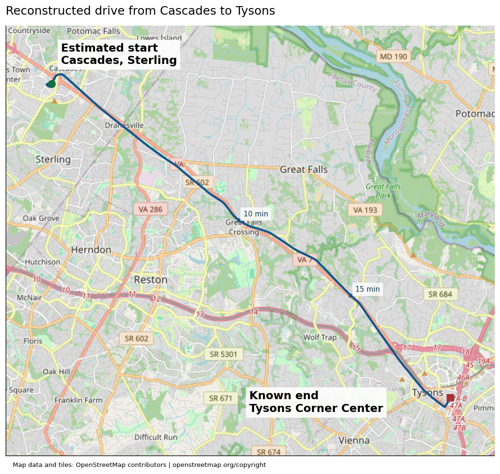
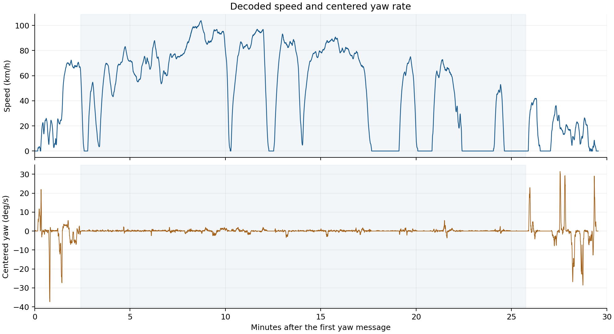
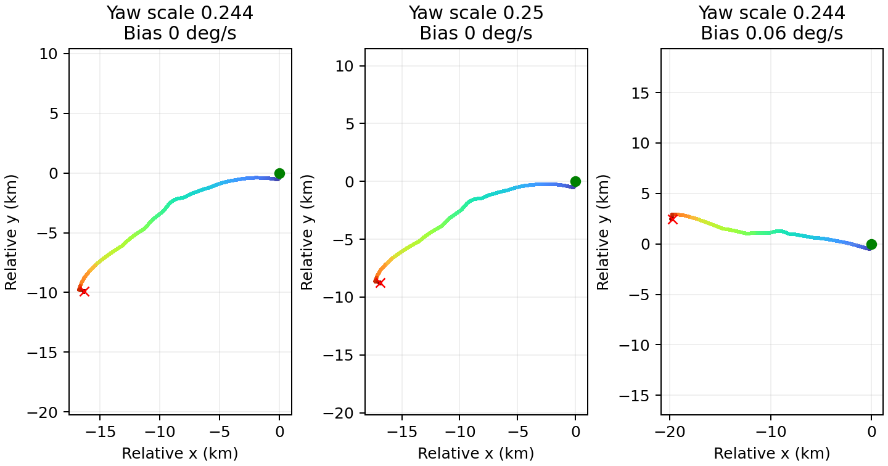
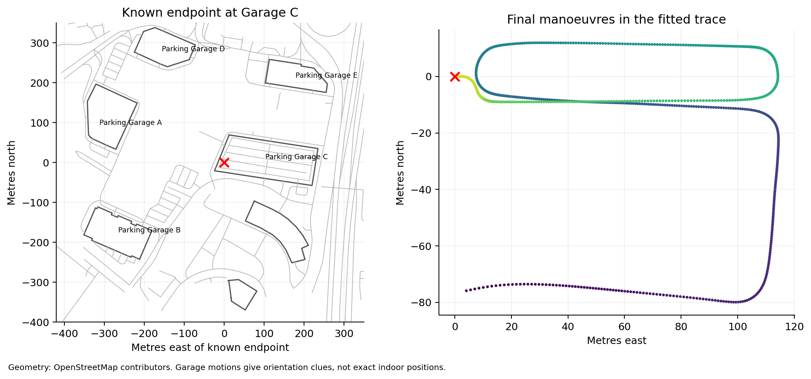
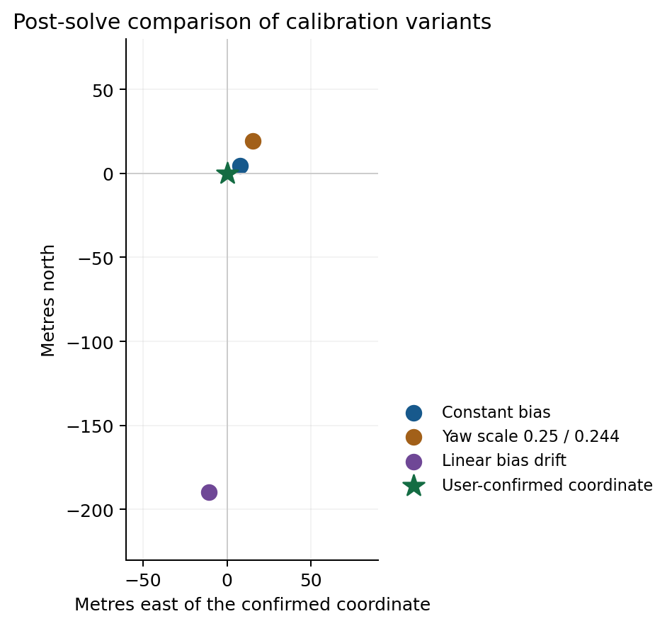

# Life is a Highway CTF writeup

## Result and scope

The user confirmed the correct starting coordinate as **39.0286785634, -77.4043945431**, in the Cascades area of Sterling, Virginia. My submitted estimate was **39.0287, -77.4043**. The separation between those two points is approximately **8.51 metres**, well inside the challenge's 1 kilometre tolerance.

I decoded speed and yaw from the CAN capture, integrated a relative driving trace, anchored its end at the supplied location, and fitted the highway section to Virginia Route 7. This produced an estimate from vehicle motion and road geometry. The ten-decimal accepted coordinate came from the user's later confirmation; those extra digits were not extracted from the log.



Figure 1. The fitted drive runs southeast from Cascades along Route 7 to Tysons. The polyline is the reconstructed CAN trajectory, so small deviations from mapped roads remain visible. Map data and tiles are from OpenStreetMap contributors.

## Challenge material

The supplied description was titled Life is a Highway, listed 10 points and the author Veryyes, and asked where a suspect's trip began. It supplied the final position **38.9166896, -77.2210292** and stated that the car was found at the top of a parking lot. The available capture was `candump-2026-08-22_185046.log.gz`; the allowed answer tolerance was 1 kilometre.

The final point was essential. Speed and yaw alone describe a trajectory up to an unknown translation and rotation, with accumulated sensor error. A known endpoint fixes the translation. Recognizable roads and the final garage manoeuvres provide clues about rotation and calibration.

| Input | Size or SHA256 |
| --- | --- |
| `description.txt` | `021332951fb5c2c4f2c9f3a2410caf5f4019e0b3b835ce36e3c0d6978f6b7a6c` |
| CAN capture | 12,689,699 compressed bytes |
| Capture SHA256 | `deb265590271624d1fa0288ab6d9171bae61377ba61ce8fdced9e8ae41dedf4e` |

The inputs in the bundle are unchanged. SHA256 hashes identify the exact bytes, so a later reader can distinguish this capture from another trip or a modified file.

## Inspecting the capture

I opened the gzip stream as text, inspected the first and last records, counted arbitration IDs, and examined per-byte ranges and the number of unique payloads. There was no need to decompress the entire log to a second text file.

A typical record looked like this:

```text
(1787439046.942595) can0 621#1100000000000000
```

The parenthesized value is a Unix timestamp in seconds. `can0` is the interface. `621` is the hexadecimal arbitration ID, and the characters after `#` are the hexadecimal payload bytes. These records use the ordinary candump log representation, not decoded diagnostic parameter names.

```python
with gzip.open(path, "rt") as stream:
    for line in stream:
        timestamp, interface, message = line.split()
        can_id, payload_hex = message.split("#")
        stamp = float(timestamp[1:-1])
        payload = bytes.fromhex(payload_hex)
```

| Capture property | Observed value |
| --- | --- |
| Total frames | 1,740,622 |
| Unique arbitration IDs | 91 |
| First timestamp | 1787439046.942595 |
| Last timestamp | 1787440832.484552 |
| Overall duration | 1,785.541957 seconds, or 29 minutes 45.54 seconds |
| Most frequent ID | `0x020`, with 147,004 frames |
| Yaw message `0x024` | 146,978 frames |
| Wheel speeds `0x0AA` | 147,002 frames |
| Vehicle speed `0x0B4` | 73,544 frames |

The many repeated records at IDs such as `0x020` were not automatically useful. I concentrated on changing signals that could explain the vehicle's movement. The byte inventory and raw samples are produced by `00_inspect_capture.py`; `capture_inventory.json` contains the complete per-ID result.

## Recognizing and validating the Toyota layout

The combination of IDs `0x024`, `0x025`, `0x0AA`, `0x0B4`, and `0x260` suggested Toyota signal definitions. I checked the common Toyota definitions in commaai opendbc's `_toyota_2017.dbc`, then tested the decoded values against the capture. A plausible make identification was useful, but a precise model year or VIN was not necessary for the solution.

The DBC names below describe the message layout used in the analysis. I did not assume that an ID alone guaranteed a correct interpretation: zero-speed wheel values, realistic driving speeds, steering activity, and agreement between yaw and wheel differences served as cross-checks.

| Hex ID | Decimal ID | DBC message | Role in the solve |
| --- | --- | --- | --- |
| `0x024` | 36 | `KINEMATICS` | Yaw rate for changes in heading |
| `0x025` | 37 | `STEER_ANGLE_SENSOR` | Supporting steering evidence |
| `0x0AA` | 170 | `WHEEL_SPEEDS` | Independent distance and turn checks |
| `0x0B4` | 180 | `SPEED` | Main speed input |
| `0x3BC` | 956 | `GEAR_PACKET` | Reverse versus forward motion |

The core DBC entries were:

```text
BO_ 36 KINEMATICS: 8 XXX
 SG_ YAW_RATE : 1|10@0+ (0.244,-125) ... "deg/s"

BO_ 180 SPEED: 8 XXX
 SG_ SPEED : 47|16@0+ (0.01,0) ... "km/h"

BO_ 956 GEAR_PACKET: 8 XXX
 SG_ GEAR : 13|6@0+ (1,0) ...
```

The `@0` notation denotes Motorola, or big-endian, DBC bit order. The byte-level formulas in the next section avoid ambiguity about how those start bits traverse bytes.

## Decoding speed yaw and gear

All payload indices in this section start at zero. If `b` is an eight-byte payload, `b[0]` is its first byte. In the saved NumPy arrays, column zero is the timestamp, so payload byte zero appears in column one. That distinction matters when reading the original scripts.

### Vehicle speed

The speed is a 16-bit unsigned value in payload bytes five and six:

```python
speed_raw = (b[5] << 8) | b[6]
speed_kph = speed_raw * 0.01
speed_ms = speed_kph / 3.6
```

For example, `0000000002008745` has speed bytes `00 87`, giving raw 135 and speed 1.35 km/h. The final byte `45` is not part of the speed field. After decoding the entire message stream, the maximum speed was **103.97 km/h**. Integrating the unsigned speed over its own timestamps gave **22.039760 km** of travelled distance.

That distance is an unsigned travel-length check, before the final fitted speed scale and before giving reverse motion a negative sign. It is not the straight-line distance between the start and end.

### Yaw rate

The yaw field uses the lowest two bits of byte zero followed by all eight bits of byte one:

```python
yaw_raw = ((b[0] & 0x03) << 8) | b[1]
yaw_dbc_deg_s = yaw_raw * 0.244 - 125.0
```

It is an unsigned ten-bit field with an offset, rather than a signed integer. The observed raw values ranged from 359 to 641. For exploratory work and fitting, I used an algebraically convenient centered form:

```python
yaw_centered_deg_s = (yaw_raw - 512) * 0.244
yaw_corrected_deg_s = yaw_centered_deg_s - bias_deg_s
```

The nominal DBC formula equals the centered formula minus **0.072 deg/s**, because `512 * 0.244 - 125 = -0.072`. Therefore an optimized bias near 0.07 is consistent with that parameterization. It should not be described as an additional 0.07 correction applied after the DBC offset; that would subtract the offset twice.

The centered yaw ranged from approximately **-37.332 to 31.476 deg/s**. Long straight segments were especially sensitive to a small constant offset. A 0.01 deg/s error accumulated for 1,000 seconds changes heading by ten degrees, enough to displace a reconstructed starting point substantially.

### Wheel speeds

Each pair of bytes in `0x0AA` contains a wheel speed. The common DBC defines a fault flag in the top bit and a 15-bit speed field. For one pair:

```python
wheel_raw = ((b[i] << 8) | b[i + 1]) & 0x7FFF
wheel_kph = wheel_raw * 0.01 - 67.67
```

The four pairs represent front right, front left, rear right, and rear left. The payload `1A6F1A6F1A6F1A6F` decodes to zero on every wheel because hexadecimal `1A6F` is decimal 6767.

| Distance source | Integrated distance in km |
| --- | --- |
| Vehicle speed `0x0B4` | 22.039760 |
| Front right | 22.045640 |
| Front left | 22.045986 |
| Rear right | 21.921167 |
| Rear left | 21.897481 |

The near agreement between the main speed and front wheels supported the speed decode. The rear differences also warned against treating raw wheel-speed differences as a perfectly calibrated yaw sensor.

### Gear and reverse

The gear code is the lowest six bits of payload byte one in `0x3BC`:

```python
gear = b[1] & 0x3F
# DBC values: 0 D, 1 S, 8 N, 16 R, 32 P
if gear == 16:
    speed_ms *= -1
```

The trip begins with a brief reverse manoeuvre. For position integration, reverse speed must be negative. The gyro continues to measure rotation of the vehicle body, so its measured yaw is not negated merely because the gear is reverse.

## Building a synchronized relative trajectory

Messages arrived at different times and rates. I resampled speed and centered yaw onto a **0.15 second** grid using linear interpolation, then assigned each grid sample the most recent gear message with `searchsorted`. The grid starts at the first `0x024` timestamp; all later time ranges in the fitting code are relative to that timestamp.

```python
grid = np.arange(yaw_timestamps[0], yaw_timestamps[-1], 0.15)
speed = np.interp(grid, speed_timestamps, speed_ms)
yaw = np.interp(grid, yaw_timestamps, yaw_centered_deg_s)
gear_index = np.searchsorted(gear_timestamps, grid, side="right") - 1
```

I formed a motion mask using unsigned speed above **0.1 m/s**, before applying the reverse sign. When that mask was false, the yaw contribution was set to zero. This avoids accumulating a quantized near-zero gyro offset during long stops. It is a practical low-speed assumption rather than a claim that every sensor sample is noiseless.

Heading is obtained by integrating angular velocity. East and north positions follow by integrating signed speed resolved along the heading. The implementation uses trapezoidal integration with the actual sample times:

```python
heading = cumulative_trapezoid(
    np.deg2rad(corrected_yaw), time, initial=0
)
east = cumulative_trapezoid(
    signed_speed * np.cos(heading), time, initial=0
)
north = cumulative_trapezoid(
    signed_speed * np.sin(heading), time, initial=0
)
```

Mathematical angles increase counterclockwise from east. A compass bearing would instead be `(90 - angle_degrees) % 360`. Mixing those conventions, using km/h as m/s, or passing degrees directly to sine and cosine would produce a fundamentally wrong trace.



Figure 2. The speed trace shows the long fast section, multiple stops, and the slower final manoeuvres. Yaw activity is concentrated around bends and parking turns.

Initially I plotted several relative paths with no map fit. Centering the gyro at raw 512 without accounting for the remaining offset gave strongly different route shapes from paths using a small bias. Changing the yaw factor from 0.244 to 0.25 also changed the geometry. Those exploratory plots established that sensor calibration, not merely a final translation, had to be part of the solve.



Figure 3. Early integrations use an arbitrary starting orientation. They illustrate how a small yaw-offset choice changes the inferred geometry over a long drive.

## Using the endpoint and road map

The supplied endpoint lies at Tysons Corner Center's **Parking Garage C** in the OpenStreetMap geometry I downloaded. The final CAN section contains repeated turns and traverses consistent with parking-garage circulation. This agreed with the challenge's statement that the car was found at the top of a parking lot.

The parking geometry helped me choose an approximate orientation to explore, but it did not by itself determine a unique route. In particular, I did not assume that every interior garage aisle or every floor was represented in the map.

For a local Cartesian frame, I placed the known endpoint at the origin and used a short-range equirectangular approximation:

```python
metres_per_lat_degree = 111111.0
metres_per_lon_degree = 111111.0 * np.cos(np.deg2rad(end_lat))
east = (longitude - end_lon) * metres_per_lon_degree
north = (latitude - end_lat) * metres_per_lat_degree
```

After integrating a candidate trace, I subtracted its last position from every point. This anchors the final sample at the known endpoint. Geographic output is then obtained by reversing the projection. The approximation is adequate for this regional reconstruction and 1 km tolerance, but its errors are part of why the fitted parameters should be viewed as effective calibration values.

### Obtaining usable road geometry

I first tried several Overpass endpoints. The responses included HTTP 406, HTTP 502, and timeouts. Larger calls to the core OSM map endpoint exceeded its **50,000 node** limit. An initial Python fetch also failed because `requests` was unavailable; I switched to the standard library's `urllib.request`.

Smaller map boxes worked. They provided enough geometry to identify the Tysons garage, inspect Route 7, and establish that the start was in the Cascades area. For a complete highway reference, the useful shortcut was retrieving route membership rather than repeatedly expanding map boxes:

```text
https://www.openstreetmap.org/api/0.6/way/227892589/relations
https://www.openstreetmap.org/api/0.6/relation/176453/full
```

The first response identified relation **176453** with `network=US:VA`, `ref=7`, and `route=road`. The second returned its member ways and nodes. This provided a continuous Route 7 reference without pulling every building and minor street in a large bounding box.

The final regional extraction retained **313 ways**, selecting primary, trunk, and motorway ways whose mean coordinate fell within latitude 38.90 to 39.06 and longitude -77.435 to -77.22. In the optimizer, a simple endpoint-eastward heuristic discarded ways whose final x coordinate was west of their first. That heuristic was sufficient for this regional eastbound route; it is not a general-purpose one-way or route-topology validator.

Reference polylines were sampled at roughly 15 metre scale, rounded to a 5 metre grid, deduplicated, and limited to points **800 metres to 20 kilometres** from the endpoint. This yielded **922 reference points**. The original program contains a comment saying 1 km, but its actual lower cutoff is 800 metres; the reproduction preserves the code's cutoff.



Figure 4. The known endpoint and final reconstructed manoeuvres support a garage interpretation. They do not establish exact positions on individual garage floors.

## Fitting the highway trace

I optimized three quantities: a constant yaw bias, a heading parameter near the final garage section, and a speed scale. The input remained the raw capture and external road geometry. The answer later confirmed by the user was not part of this optimization.

| Parameter | Search interval | Meaning |
| --- | --- | --- |
| Yaw bias | 0.04 to 0.14 deg/s | Subtracted from the centered yaw signal while moving |
| Heading at 1735 seconds | 160 to 185 degrees | Mathematical angle counterclockwise from east |
| Speed scale | 0.98 to 1.02 | Multiplier on signed decoded speed |

To avoid recomputing the same integrals for every candidate, I precomputed the centered yaw integral and cumulative moving time. I subtracted their values at the sample nearest **1735 seconds**. This made the heading parameter refer to that late-trip sample rather than to the unknown initial orientation.

```python
angle = (
    yaw_integral_relative_to_reference
    - np.deg2rad(bias) * moving_time_relative_to_reference
    + np.deg2rad(reference_heading)
)
```

For each candidate, I integrated the scaled signed speed with this angle, anchored the last position at zero, and considered the trajectory between **145 and 1545 seconds** for road matching. That interval focuses on the highway travel and excludes most of the initial parking and final garage movements.

The objective was specifically **road point to trajectory**, not the reverse. I built a KD-tree of the candidate highway trajectory, queried it with each retained Route 7 reference point, capped distances at 3,000 metres, and minimized mean squared distance:

```python
tree = cKDTree(candidate_xy[highway_mask])
distances = tree.query(road_reference_points)[0]
loss = np.mean(np.minimum(distances, 3000.0) ** 2)
```

I used SciPy differential evolution with `seed=2`, `popsize=9`, `maxiter=100`, `tol=0.00001`, `polish=True`, and one worker. The seed makes the recorded search reproducible in the documented environment. A fixed seed does not guarantee bit-for-bit agreement across every future numerical-library version.

The full-road fit returned:

```text
Start latitude                 39.02871982814972
Start longitude               -77.40430815743889
Yaw bias                       0.07041628058182295 deg/s
Heading at reference           180.4853612120586 degrees
Speed scale                    1.0151222330144072
Road point to trace RMS         132.10971255337884 m
```

That heading is approximately compass bearing 269.515 degrees, because the script uses counterclockwise angles from east. The fitted bias is close to the nominal 0.072 offset in the centered-yaw parameterization. The roughly 1.5 percent speed adjustment was a fitted geometric scale, not a separately verified correction to the car's speedometer.

The **132.11 m RMS is an optimization score**, not measured GPS position error and not a statistical confidence radius. The fit compares sampled mapped roads with a reconstructed trace; it does not know the actual location of every recorded frame. It also does not enforce a full road-network traversal or lane-level constraints.

## Calibration checks and discarded approaches

I repeated the fit with modest model changes to see whether the inferred start was stable. These checks happened before the submitted answer. The confirmed point is used only for the post-solve comparison in the figure below.

| Calibration | Start latitude | Start longitude | Road fit RMS in m |
| --- | --- | --- | --- |
| Constant bias with local refinement | 39.028718010 | -77.404304571 | 132.110 |
| Yaw gain changed by 0.25 divided by 0.244 | 39.028854165 | -77.404216406 | 134.967 |
| Linear bias drift allowed | 39.026971143 | -77.404519121 | 118.105 |

The linear-drift model obtained a lower road-distance score but drove its heading to the expanded **190 degree upper bound**. More model freedom can reduce an objective without establishing a better physical reconstruction. I retained the simpler constant-bias result. The most different start among these variants was about 200 metres from the main estimate, which supported the original region estimate but did not constitute a rigorous 200 metre uncertainty bound.



Figure 5. Positions are shown relative to the coordinate the user confirmed after the solve. The original calibration checks did not have that reference point available.

### Wheel differential and lateral acceleration

As a sign and motion check, I compared yaw with the rear-right minus rear-left wheel speed during strong turns. Their correlation was **0.994585**. A regression of centered yaw against rear speed difference, mean rear speed, and a constant produced coefficients approximately **37.1343, -0.0233533, -0.129092**. This supported the turn direction and signal interpretation.

I did not make that wheel regression the final dead-reckoning model. Different speed selections gave inconsistent apparent track-width estimates, and small rolling-radius differences accumulate over kilometres. An exploratory 1.53 m track assumption was only a diagnostic guess, not a verified specification used in the answer. I also tried comparing lateral acceleration divided by speed with gyro yaw; the speed-dependent results were not stable enough to replace the yaw model. Road banking, tilt, offsets, and motion transients are possible confounders in that comparison.

### A misleading local parking fit

A distance-only fit of the final approach to nearby drivable map lines returned a rotation near **245.02 degrees** and an apparently attractive **9.91 m RMS**. Visual inspection showed that this local solution did not give a plausible garage traversal. This was a useful warning: matching a short path to nearby lines is ambiguous, especially around buildings and stacked parking floors. That rotation was discarded.

### The separate starting-area experiment

The original `fit_start.py` attempted another local alignment of the early trace to roads near Cascades. It returned approximately **39.031501443, -77.406571948**, with an RMS near **59.04 m** and rotation **-29.75 degrees**, close to the allowed -30 degree boundary. That was an exploratory result from an earlier global-fit snapshot, not the submitted coordinate. Local road proximity and a lower local score did not outweigh the whole-trip reconstruction.

The unchanged script and its saved output are included so this experiment is visible rather than silently removed. Its saved input state predated the final full-road fit; a rerun against the final snapshot can therefore differ from that historical local result.

## Reproducing the result

The bundled reproduction uses Python, NumPy, SciPy, Matplotlib, and Pillow. The recorded environment was Python **3.12.14**, NumPy **2.3.5**, SciPy **1.17.0**, Matplotlib **3.10.8**, and Pillow **12.3.0**. The final numerical path does not require `cantools`, a GPS decoder, an online route service, or a live Overpass instance.

From the extracted bundle directory:

```bash
python -m venv .venv
# Activate the environment as described in README.md
python -m pip install -r requirements.txt
python run_all.py
```

The ordered stages are:

| Script | Output or purpose |
| --- | --- |
| `00_inspect_capture.py` | Frame inventory, ID counts, payload ranges and input hashes |
| `01_extract_signals.py` | Timestamped byte arrays, gear series and decoded signal statistics |
| `02_reconstruct_relative.py` | Early integrations and yaw-offset comparison |
| `03_prepare_road_geometry.py` | The 313 regional Route 7 ways from the frozen relation |
| `04_fit_route.py` | Final three-parameter fit, coordinates and full route CSV |
| `05_check_calibration.py` | Constant, alternate-gain and linear-drift sensitivity checks |
| `06_make_figures.py` | Report figures from the reproduced results |
| `07_fetch_reference_data.py` | Optional live reference refresh into a separate folder |
| `08_probe_wheel_model.py` | Independent wheel and yaw cross-check |
| `09_validate_confirmed_coordinate.py` | Post-solve distance comparison with the user's answer |
| `common.py` | Shared parsing, projection, integration and fitting functions |
| `run_all.py` | Ordered offline runner for the main workflow |

The runner calls validation before figure generation and skips the optional network refresh. `output/fitted_route.csv` contains the reconstructed latitude and longitude at each 0.15 second sample. `fit_result.json`, `calibration_variants.json`, `postsolve_validation.json`, and `verification.json` make the main results easy to inspect without parsing terminal output.

For the original final optimizer, enter `session_archive/` and run `python fit_analysis.py`, followed by `python check_variants.py`. Those files are preserved unchanged. `SCRIPTS.md` collects their full source and all reproduction scripts in one file. `session_archive/inline_exploration.py` is explicitly labeled as a writeup-time reorganization of inline exploratory code, rather than an original saved program.

### What was verified for this package

I ran the complete offline pipeline from the included capture. The extracted signal arrays, final road-reference geometry, fitted parameters, and final trajectory arrays were identical to the original session's saved arrays in the documented environment. All packaged Python files were compiled for syntax validation. The optimizer reported successful termination.

The reproduced full-road estimate is approximately **8.76 metres** from the confirmed coordinate. The rounded coordinate I originally gave is approximately **8.51 metres** away. These are post-solve comparisons, computed with the haversine formula, and are distinct from the road-fitting RMS and calibration variation.

## Sources and limits

The challenge description and CAN capture supplied the task, endpoint, raw measurements, and tolerance. Toyota signal definitions came from the frozen copy of commaai opendbc's common Toyota DBC. Road geometry and the regional map tiles came from OpenStreetMap. The complete reference responses used for the final fit are bundled, so later edits to online maps do not change the documented replay.

The map snapshots were retrieved during this solve and are not an archival reconstruction of the exact road map on the capture date. The accepted starting point confirms that the answer was sufficient for the challenge; it does not prove that the entire reconstructed route is exact to metres or that the model recovered physical sensor calibration uniquely.

The key to the solve was combining three constraints: a plausible decoded motion trace, a fixed endpoint, and the geometry of the highway travelled. The final point was an inference from that combination. The user confirmation established which coordinate was accepted.

| Reference | URL |
| --- | --- |
| Common Toyota DBC | https://raw.githubusercontent.com/commaai/opendbc/master/opendbc/dbc/generator/toyota/_toyota_2017.dbc |
| opendbc project | https://github.com/commaai/opendbc |
| Route 7 relation | https://www.openstreetmap.org/relation/176453 |
| Route 7 full API response | https://www.openstreetmap.org/api/0.6/relation/176453/full |
| OpenStreetMap attribution | https://www.openstreetmap.org/copyright |

The full script source follows separately in `SCRIPTS.md` and the individual Python files. The archive notes retain failed service requests, intermediate fits, and discarded experiments alongside the successful method.
